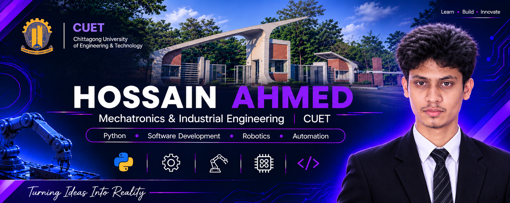
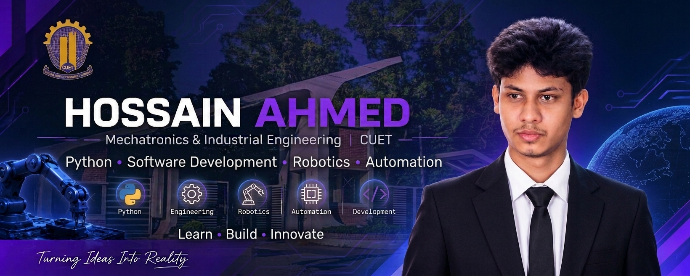

# Hey, I'm Hossain Ahmed!

  

  

  

<h2 align="center">
  Mechatronics & Industrial Engineering Student @ CUET
</h2>

  <b>Engineering | Programming | Robotics | Automation</b>

  Learning, building, and turning ideas into practical solutions.

  

  
  
  
  
  

---

## 👨‍💻 About Me

I'm an undergraduate student at **Chittagong University of Engineering & Technology (CUET)**, pursuing my **Bachelor of Science (B.Sc)** degree in **Mechatronics and Industrial Engineering (MIE)**.

I'm interested in the intersection of programming and engineering: how software, intelligent systems, and automation can solve practical problems.

Currently, I'm building my foundation in programming and engineering while exploring the technologies that will help me turn ideas into working solutions.

- 🎓 Mechatronics & Industrial Engineering student at CUET.
- 🐍 Learning Python and strengthening programming fundamentals.
- 💻 Interested in software development and backend engineering.
- 🤖 Exploring robotics, control systems, and industrial automation.
- ⚙️ Interested in mechanical systems and real-world engineering applications.
- 🧠 Working on problem-solving, logical thinking, and technical skills.

## 🛠️ Technologies & Tools

### Programming Languages

  
  

### Development Tools

  
  
  

### Areas of Interest

  
  
  
  
  

## 🚀 Projects

I use my repositories to document what I'm learning, experiment with ideas, and build practical projects.

**My focus:** Projects that combine programming, problem-solving, and real-world engineering applications.

*More projects coming as I build and complete them.*

## 🎯 Current Focus

- 🐍 Strengthening Python programming fundamentals.
- 🧩 Improving problem-solving and computational thinking.
- ⚙️ Applying programming to engineering problems.
- 🤖 Exploring robotics, automation, and control systems.
- 💻 Learning to build useful software applications.
- 📚 Developing strong engineering fundamentals.

## 🎓 Education

**Chittagong University of Engineering & Technology (CUET)**

Bachelor of Science in Mechatronics and Industrial Engineering (MIE)

Bangladesh

## 🤝 Let's Connect

I'm always interested in learning, sharing ideas, and connecting with people interested in programming and engineering.

- **GitHub:** [hossain2509013](https://github.com/hossain2509013)
- **X:** [@hossain2509013](https://x.com/hossain2509013)
- **Facebook:** [hossain2509013](https://www.facebook.com/hossain2509013)
- **YouTube:** [@hossain25O9O13](https://www.youtube.com/@hossain25O9O13)
- **Email:** [u2509013@student.cuet.ac.bd](mailto:u2509013@student.cuet.ac.bd)

---

  

  <i>Learn continuously. Build practically. Engineer with purpose.</i>

<!--
**hossain2509013/hossain2509013** is a ✨ _special_ ✨ repository because its `README.md` (this file) appears on your GitHub profile.

Here are some ideas to get you started:

- 🔭 I’m currently working on ...
- 🌱 I’m currently learning ...
- 👯 I’m looking to collaborate on ...
- 🤔 I’m looking for help with ...
- 💬 Ask me about ...
- 📫 How to reach me: ...
- 😄 Pronouns: ...
- ⚡ Fun fact: ...

-->
